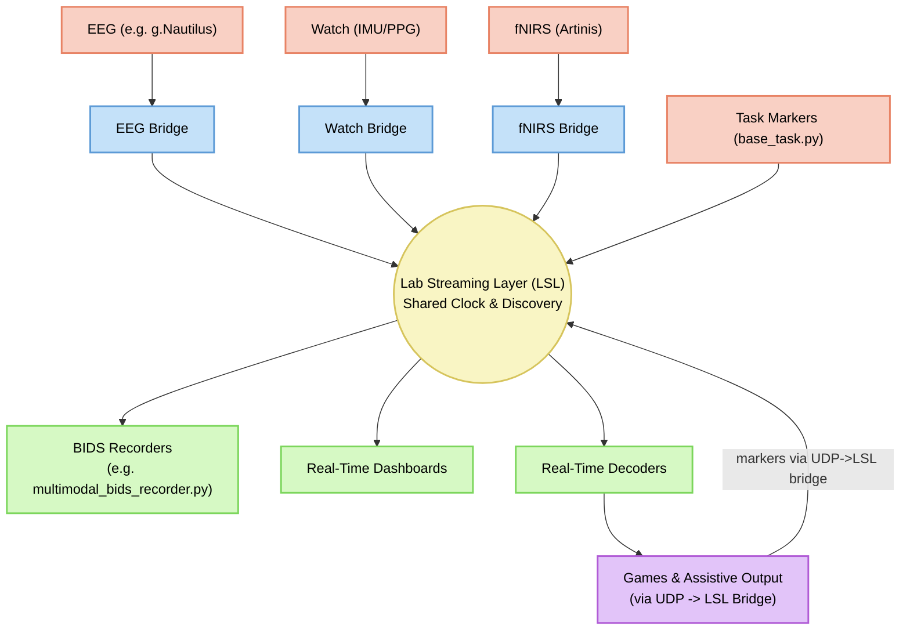

# Nautilus BCI

Welcome to the Nautilus BCI project. This suite serves as a multimodal hub for Brain-Computer Interface research. Device repositories and bridges (like g.Nautilus, Galaxy Watch, Artinis fNIRS) publish Lab Streaming Layer (LSL) streams, and Nautilus strictly acts as a consumer of these streams, integrating data seamlessly without needing to import device-specific code. LSL provides automatic discovery and a shared time base, ensuring hardware streams, task markers, and experimental environments operate under a unified synchronization protocol before being stored cleanly into Multimodal BIDS format.

**Important First Step**: Please ensure you configure your system properly by following the [LSL Network Setup](guides/lsl_network_setup.md) guide.

## System Architecture Data Flow

